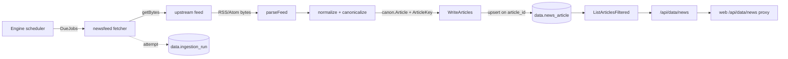

# Crypto News & Intelligence Ingestion Engine

Status: **implemented and live-verified** (2026-10-11).
Owner surface: `apps/data` (Go), `apps/web` (proxy route only).

## What this is

A durable, source-agnostic news ingestion engine that collects from crypto news
publishers, regulators, security researchers, and research desks; normalizes
every record into one canonical row; and serves it back through the existing
`/api/data/news` read surface.

It is deliberately **not** a new subsystem. It reuses the pieces FUDCourt
already has:

| Concern | Reused component |
|---|---|
| Scheduling, rate limiting, circuit breaking, retry/backoff, bounded workers, graceful shutdown | `ingest.Engine` (`apps/data/internal/ingest`) |
| Job registry + double-dispatch guard | `data.job` via `JobStore` |
| Per-attempt audit trail | `data.ingestion_run`, `data.ingestion_error` |
| Durable storage | `data.news_article` (no new tables) |
| Canonical row shape | `canon.Article` |
| Article identity | `canon.ArticleKey(provider, providerArticleID)` |
| Write path | `canon.Writer.WriteArticles` (`repo.Repo`) |
| Read path | `canon.Reader.ListArticles` / `ListArticlesFiltered` |
| HTTP guards | `platform/httpx` transport |

No Kafka, no RabbitMQ, no second scheduler, no Valkey lock layer, no
Elasticsearch, no new database tables, and no new third-party dependencies.

## Package layout

```
apps/data/internal/ingest/providers/newsfeed/
  doc.go         package contract, source-inventory policy, reuse list
  client.go      HardError, newClient, getBytes (SSRF guard, size cap, conditional GET)
  sources.go     Source registry (Go table) + ValidateSources + manifest loader
  parse_feed.go  RSS 2.0/1.0 + Atom 1.0 parsers, tag stripping, entity unescaping
  normalize.go   canonical URL, content hash, flexible time parsing, entity tagging
  module.go      ingest.Module: Provider / Fetchers / Jobs; fetcher.Fetch
  newsfeed_test.go  unit suite (fake Doer, no network)
  live_test.go      live smoke suite (build tag `live`, real fetches)
```

`apps/data/internal/ingest/repo/e2e_live_test.go` is a live end-to-end test that
runs the real write/read path inside a transaction that always rolls back.

## Data flow



## Two distinct news surfaces

This is the single most important thing to understand about the news feature:

| Surface | Served by | Backing | Contract |
|---|---|---|---|
| `GET /api/news` | `apps/data/internal/research/news` | Windsurfed: a **stateless relay** of one publisher's RSS feed, read live per request | Wire contract pinned: `Source{Name,Label,URL}` table, exact 400 detail text, `news:1 feeds` in healthz, asserted by `scripts/verify/verify-news.py` |
| `GET /api/data/news` | `apps/data/internal/ingest/serve` | **The store**: every article the ingestion engine has ever written, across all sources | Filters + keyset cursor (this document) |
| `GET /api/data/news` (web) | `apps/web/src/app/(frontend)/api/data/news/route.ts` | Thin proxy to the sidecar | Relays `Cache-Control`, `Link`, `ETag` |

`/api/news` resolves through the `[...path]` gateway (family name only); the
dedicated `/api/data/news` route exists because that gateway drops subpaths.

**Do not add rows to the research `Sources` table.** It is the relay's wire
contract: adding a feed changes the published 400 payload and the healthz feed
count that `verify-news.py` asserts.

## Record model

Rows are `canon.Article`, stored in `data.news_article`:

| Field | Meaning |
|---|---|
| `ArticleID` | `canon.ArticleKey("newsfeed", providerArticleID)` — stable natural key |
| `Headline` | Article title, tags stripped |
| `Summary` | Description/summary, tags stripped, entities unescaped |
| `URL` | Canonical URL (tracking parameters removed, host lowercased) |
| `Publisher` | Outlet display name (`The Defiant`, `Cointelegraph`, …) |
| `PublishedAt` | Feed's own timestamp (nullable — never fabricated) |
| `Language` | BCP 47, from the source row |
| `Topics` | Source topic tags merged with the feed's own categories |
| `Assets` | Canonical asset ids mentioned on word boundaries (`BTC`, `ETH`, …) |
| `Source` | Ingestion family (`newsfeed`) |
| `RetrievedAt` | Ingestion clock, always `time.Now().UTC()` at write time |

### Two timestamp rules that are load-bearing

1. `RetrievedAt` is **never** the feed's `pubDate`. `repo.validateArticle`
   rejects any `retrieved_at` beyond `now+5min`, so a feed with clock skew (or a
   future-dated item) would otherwise poison every row.
2. `PublishedAt` carries the feed timestamp and stays `nil` when the feed omits
   it. Absence is `nil`, never epoch and never `now`.

### Identity and idempotency

`providerArticleID` is the feed's `<guid>`/`<id>` when present, else a SHA-256
of `canonicalURL + headline`. `ArticleKey` namespaces it under the provider.

Idempotency is structural:

- `data.news_article.article_id` is the primary key.
- `UNIQUE (provider, provider_article_id)` backs the natural key.
- `WriteArticles` issues `INSERT … ON CONFLICT (article_id) DO UPDATE`.

**Verified**: re-fetching all 50 Blockworks rows reported `RowsWritten: 50`
(every row was an upsert) while the table count stayed at exactly 481 — no
duplicate minting despite repeated cycles.

### `Source` vs `Publisher` when filtering

`WriteArticles` stores the adapter family in *both* `provider` and `source`
(`newsfeed`). The outlet lives in `publisher`. A filter keyed only on `source`
would therefore collapse every publisher into one bucket — so
`ListArticlesFiltered` matches `publisher = $1 OR source = $1`, which selects a
single outlet by name and still accepts the family.

## Sources and inventory policy

The 158-entry planning inventory is **not present** in this repository or in the
execution context; no manifest file and no source-list file exist. Nothing was
fabricated to fill the gap.

- Runtime truth is the `Sources` table in `sources.go`.
- `manifest.json` is the version-controlled audit trail; an explicitly provided
  inventory drops in via `LoadManifest` and is validated by `ValidateSources`.
- Every entry carries `Status` **and** `Evidence` (probe result) or
  `BlockReason`. A source is `working` only after a live probe returned
  `200` + a parseable feed + at least one item. Configuration alone never marks
  a source working.

Coverage as of 2026-10-11: see `docs/architecture/news-sources.md`.

## Filters and pagination (`GET /api/data/news`)

| Param | Effect |
|---|---|
| `limit` | Page size; default 100, clamped to 1000 |
| `source` | Outlet name (`The Defiant`) or family (`newsfeed`) |
| `category` | Member of `topics` |
| `asset` | Member of `assets` (uppercased for you) |
| `search` | Case-insensitive substring over headline + summary |
| `before` | Keyset cursor: RFC 3339 timestamp or `YYYY-MM-DD`; returns articles strictly older |

Pagination is **keyset, not offset**: the query is `published_at < before`
ordered `published_at DESC NULLS LAST`. Under concurrent writes a keyset cursor
cannot skip or repeat rows the way `OFFSET` can. A full page sets a `Link:
<…>; rel="next"` header carrying the next `before` value.

Rows with a NULL `published_at` sort last and are returned only on an
uncursored read; the cursor predicate is `published_at IS NOT NULL AND
published_at < $n` so the NULL tail is never re-served forever. Every
dispatched source carries a feed timestamp, so the tail is empty in practice.

Filters never 400 on an unknown value — an unknown outlet yields an empty page.
`limit` and `before` are validated and do 400 on malformed input.

## Safety properties

| Threat | Mitigation |
|---|---|
| SSRF | `ssrfBlocked` rejects non-http(s), userinfo, empty host, `localhost`, and literal private/loopback/link-local/multicast IPs — re-checked on the final redirect URL. Hostnames that *resolve* to private IPs are not resolved pre-flight (documented limitation). |
| Decompression / oversized bodies | Body buffered through `io.LimitReader(maxBodyBytes)`. Reaching the cap is a loud `shape` HardError — a truncated body is never parsed. |
| Slow upstreams | Per-request timeout (30s default) plus the engine's own dispatch budget. |
| Retry storms | Fetchers make exactly one attempt and return typed errors; the engine owns backoff and the circuit breaker. `Retry-After` on a 429 is surfaced in the error detail. |
| Bandwidth waste | `ETag`/`Last-Modified` are persisted in the job cursor and replayed as `If-None-Match`/`If-Modified-Since`; a 304 short-circuits to zero rows. |
| Publisher overload | One request per source per cycle, sequential dispatch under the engine's per-provider rate limiter; polite UA. |
| Access-control bypass | Paywalled, bot-challenged, or credential-gated sources are recorded `restricted` / `pending_credentials` with the probe result. No CAPTCHA, paywall, or anti-bot circumvention. |

## Error taxonomy

`HardError{Kind, URL, Status, Detail}` is declared **per provider package** (the
`cftc`/`bi` convention) — there is no shared error type to import.

| Kind | Meaning | Engine behavior |
|---|---|---|
| `transport` | DNS, dial, TLS, blocked URL | retry with backoff |
| `status` | non-2xx (429 carries `retry-after:<v>`) | retry with backoff |
| `shape` | body cap hit, unparseable feed, unknown dataset | retry with backoff |
| `api-error` | provider error envelope | retry with backoff |
| `no-credentials` | source is not dispatchable | terminal |

## Error isolation

One failing source cannot affect another: each source is a separate dataset job,
dispatched through its own rate limiter and breaker slot, and every failure is
journaled to `data.ingestion_run` / `data.ingestion_error` rather than
propagated. `Retention` sweeps by dataset TTL as it does for every other family.

## Extending the registry

To add a source:

1. Probe it and record the real result. Never write an endpoint you have not
   fetched.
2. Append a `Source` row in `sources.go` with `Status` + `Evidence` (working) or
   `Status` + `BlockReason` (blocked).
3. Run `ValidateSources` (exercised by the unit suite) and the live smoke:

   ```bash
   go test -tags live ./apps/data/internal/ingest/providers/newsfeed/ -run TestLiveSources -v
   ```

No other code changes are needed for a new RSS/Atom feed: the fetcher set and
the job seeds are both derived from the table.
